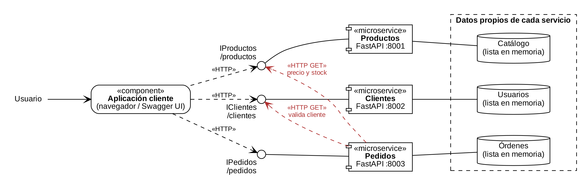
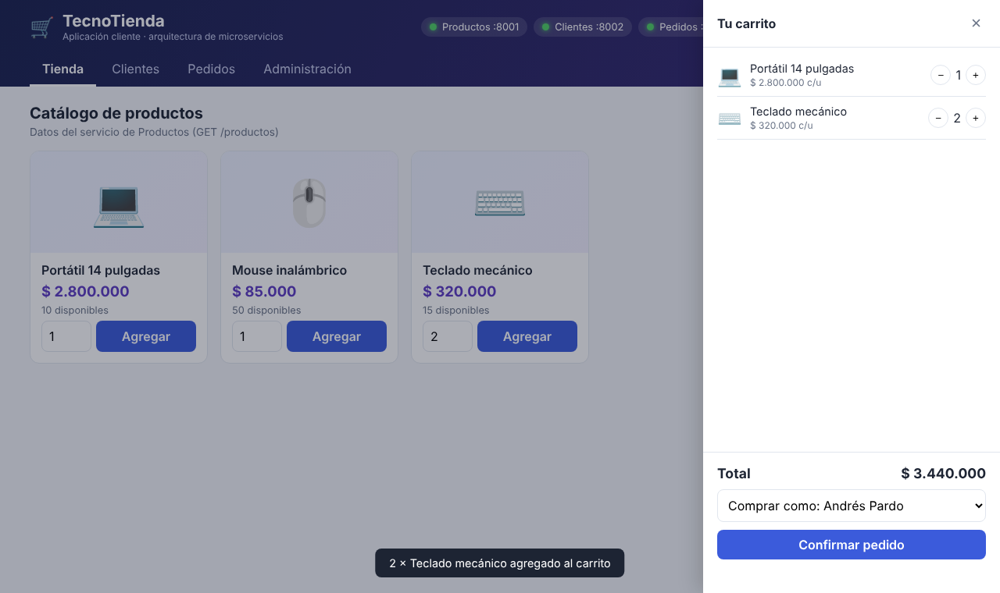
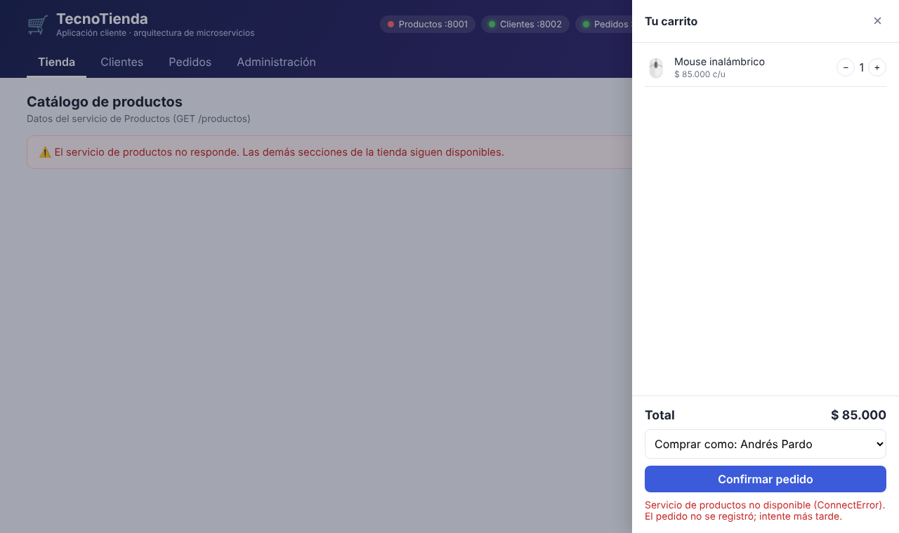

# Taller 5. Arquitectura de Microservicios: Tienda Virtual

Universidad Manuela Beltrán · Ingeniería de Software · Arquitectura de Software / Sistemas Distribuidos

Solución básica de una tienda virtual dividida en tres microservicios independientes con **Python y FastAPI**, comunicados mediante **API REST**, y una aplicación cliente web que los consume.

| Servicio | Puerto | Operaciones | Depende de |
|---|---|---|---|
| Productos (`productos.py`) | 8001 | `GET /productos`, `GET /productos/{id}`, `POST /productos`, `GET /salud` | Ninguno |
| Clientes (`clientes.py`) | 8002 | `GET /clientes`, `GET /clientes/{id}`, `POST /clientes`, `GET /salud` | Ninguno |
| Pedidos (`pedidos.py`) | 8003 | `POST /pedidos`, `GET /pedidos`, `GET /pedidos/{id}`, `GET /salud` | Clientes y Productos (HTTP GET) |

Pedidos valida el cliente y cada producto en los otros servicios, calcula el total y maneja fallos con tiempo de espera (2 s), dos reintentos y respuesta **503** cuando un servicio requerido no responde.



## Ejecución

**Windows:** doble clic en `iniciar_servicios.bat`. Instala dependencias, levanta los tres servicios y abre `tienda.html`.

**Manual:**

```bash
pip install -r requirements.txt
python -m uvicorn productos:app --port 8001
python -m uvicorn clientes:app  --port 8002
python -m uvicorn pedidos:app   --port 8003
```

Luego abra `tienda.html` en el navegador o la documentación Swagger en `http://127.0.0.1:8001/docs`, `:8002/docs` y `:8003/docs`.

**Google Colab / Jupyter:** abra `Taller5_Microservicios.ipynb` y ejecute todas las celdas; incluye las pruebas de las API y la prueba de fallo.

## Aplicación cliente web



Con el servicio de Productos detenido, el resto de la tienda sigue funcionando y el pedido responde 503:



> Los datos se guardan en listas en memoria para simplificar el ejercicio; se reinician al detener los servicios.
